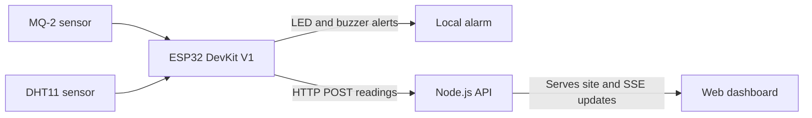

# 🔥 Emberwatch

<div align="center">

### Smart Fire Detection & Alert System

An ESP32 sensor prototype with local alarms and a live web dashboard.


</div>

Emberwatch reads temperature, humidity, and raw smoke-sensor values. The ESP32 controls the LEDs and buzzer directly; the website displays readings, connection status, event history, and fire alerts.

> **Educational prototype:** this project is not a certified life-safety device. Keep approved smoke and fire alarms installed. MQ-2 values are raw ADC readings, not calibrated smoke concentration or ppm.

## Contents

- [What it does](#what-it-does)
- [System overview](#system-overview)
- [Hardware and wiring](#hardware-and-wiring)
- [Run locally](#run-locally)
- [Configure and upload the ESP32](#configure-and-upload-the-esp32)
- [Thresholds](#thresholds)
- [Deploy publicly](#deploy-publicly)
- [API](#api)
- [Troubleshooting](#troubleshooting)

## What it does

- Samples an **MQ-2** smoke/gas sensor and **DHT11** temperature/humidity sensor.
- Averages five MQ-2 ADC samples to reduce noise.
- Drives the safe LED, alert LED, and buzzer from the ESP32.
- Posts readings to a small Node.js API about every two seconds.
- Updates the dashboard live using server-sent events (SSE).
- Shows current device status, sensor readings, alert history, and a fire popup.
- Runs in Docker with Compose; the Node backend has no third-party package dependencies.

## System overview



The local LED and buzzer alerts work independently of the website and internet connection. The computer running the backend must be reachable by the ESP32 for dashboard updates.

## Hardware and wiring

This firmware is written for an **ESP32 DevKit V1**. A classic Arduino Uno needs a separate Wi-Fi module and different firmware.

| Component | ESP32 connection |
| --- | --- |
| DHT11 data | GPIO 4 |
| MQ-2 analog output | GPIO 34 through a voltage divider |
| Red alert LED | GPIO 18 through a 220–330 Ω resistor |
| Green safe LED | GPIO 19 through a 220–330 Ω resistor |
| Active buzzer driver | GPIO 26 through an NPN transistor |
| Shared ground | Connect all component grounds to ESP32 GND |

**Power and wiring notes**

- Power the MQ-2 module as required by its board, commonly 5 V. Do **not** connect a 5 V analog output directly to an ESP32 input. Use a divider to bring it below 3.3 V; the README's suggested 10 kΩ / 10 kΩ divider produces about 2.5 V from a 5 V signal.
- Drive the buzzer through an NPN transistor, not directly from the ESP32 GPIO. Use a flyback diode for a magnetic buzzer.
- A bare DHT11 may need a pull-up resistor between DATA and 3.3 V; many sensor modules include one.
- Check the pin labels and voltage requirements of your exact modules before wiring.

## Run locally

### Start with Docker

Install Docker Desktop and start it. From the project folder, open a terminal and run:

```powershell
Copy-Item .env.example .env  # only needed the first time
docker compose up --build -d
```

Open **http://localhost:3000**. View backend logs with `docker compose logs -f`; stop the container with `docker compose down`. The named Docker volume keeps `.data` across container rebuilds.

If PowerShell says `.env` already exists, skip the copy command. Compose uses development mode locally, so the example API key works for a local demo. Replace it with a private key before putting the backend on a public server.

### Run directly with Node (optional)

Install Node.js 18 or later. Copy `.env.example` to `.env` if needed, then run `npm start` from the project folder. Open **http://localhost:3000**.

### 2. Point the ESP32 at your computer

Find the computer's current Wi-Fi IPv4 address with `ipconfig`. In `firmware/esp32_fire_alert/Config.h`, set:

```cpp
#define WIFI_SSID "your-2.4-GHz-network"
#define WIFI_PASSWORD "your-wifi-password"
#define API_URL "http://YOUR_COMPUTER_IPV4:3000/api/readings"
#define DEVICE_API_KEY "the-same-private-key-as-in-.env"
```

Replace `YOUR_COMPUTER_IPV4` with the computer's address on the same Wi-Fi network, for example `192.168.1.25`. Do not use `localhost` here: from the ESP32, that would refer to the ESP32 itself. If Windows Firewall asks, allow Node.js on your private network.

### 3. Upload the firmware

1. Open `firmware/esp32_fire_alert/esp32_fire_alert.ino` in Arduino IDE.
2. Install the ESP32 board package, **DHT sensor library by Adafruit**, and **Adafruit Unified Sensor** if they are not installed.
3. Select your ESP32 board and port, then click **Upload**.
4. Open Serial Monitor at **9600 baud**.
5. Look for `Wi-Fi connected` and `Dashboard update sent (HTTP 2xx)`.

The dashboard should begin showing the latest readings and device status.

## Thresholds

The starter thresholds match the supplied project code. The backend's `.env` values and firmware's `Config.h` values should stay in sync.

| Reading | Warning | Fire alert |
| --- | ---: | ---: |
| Temperature | 30 °C | 35 °C |
| MQ-2 raw ADC | 225 | 300 |

The MQ-2 value is an ADC count from **0 to 4095**, not ppm. MQ-2 modules vary and need warm-up and individual calibration. These are demo thresholds, not validated fire limits. Never test the system by lighting a fire.

## Connect the Vercel site to a Docker backend

The Node server serves the dashboard and API together. A Docker container on your own computer is private; the public Vercel site cannot reach it. For the deployed site, run this Docker image on a publicly reachable server that supports Docker, HTTPS, and persistent storage.

1. Build and start the image on your Docker host. Expose its `PORT` (3000 by default) and mount persistent storage at `/app/.data`.
2. Set these environment variables on that host:

   ```text
   NODE_ENV=production
   PORT=3000
   WEB_ORIGINS=https://gas-detection-gules.vercel.app
   DEVICE_API_KEY=<your-private-random-key>
   TEMP_WARNING_C=30
   FIRE_TEMP_C=35
   SMOKE_WARNING_RAW=225
   SMOKE_RAW_THRESHOLD=300
   ```

3. Set `window.EMBERWATCH_API_BASE` in `public/config.js` to the backend's public origin, for example `https://your-backend.example.com`, and redeploy the Vercel site. Do not add `/api` to the origin; the dashboard appends API paths itself.
4. Set the firmware `API_URL` to `https://your-backend.example.com/api/readings`, use the same `DEVICE_API_KEY`, add the host's trusted root certificate to `SERVER_ROOT_CA`, and upload the sketch again.
5. Open `https://your-backend.example.com/api/health`. A JSON response confirms the API is running.

The backend checks `WEB_ORIGINS` to allow browser requests from the Vercel site. Keep `.env`, Wi-Fi credentials, and private API keys out of GitHub. `.gitignore` excludes `.env` and `.data`.

## API

The firmware sends `POST /api/readings` with an `X-Device-Key` header. The dashboard uses the following endpoints:

| Endpoint | Purpose |
| --- | --- |
| `GET /api/health` | Check that the API is running |
| `GET /api/state` | Get the latest reading and device status |
| `GET /api/history` | Read recent sensor and alert history |
| `GET /api/stream` | Receive live updates using SSE |
| `POST /api/readings` | Submit an ESP32 reading; requires the device key |

## Troubleshooting

| Symptom | Check |
| --- | --- |
| ESP32 cannot find the network | Use a 2.4 GHz Wi-Fi network; verify the SSID exactly, and keep an iPhone hotspot's compatibility option enabled if using one. |
| Local dashboard stays offline | Confirm the Docker container is running with `docker compose ps` and open the dashboard at `http://localhost:3000`. |
| Vercel dashboard stays offline | Confirm `public/config.js` points to the public backend origin and the backend's `WEB_ORIGINS` includes the exact Vercel site origin. |
| API responds with an authorization error | Make `DEVICE_API_KEY` identical in the backend environment and `Config.h`. |
| HTTP/TLS request fails after public deployment | Confirm `API_URL` uses HTTPS and `SERVER_ROOT_CA` contains the provider's trusted root CA certificate. |
| DHT11 values show as unavailable | Check DATA wiring, power, common ground, and the selected DHT11 library. |
| MQ-2 numbers look unexpected | The display is raw ADC; check the divider, power, warm-up, and sensor-specific calibration. |

---

<div align="center">

**Emberwatch · ESP32 + Node.js · Built for an educational project**

</div>
