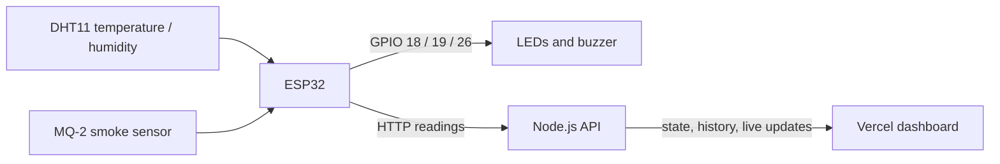

# Emberwatch

<div align="center">

## 🔥 Smart Fire Detection & Alert System

**A connected ESP32 prototype for early fire-condition monitoring**

Reads temperature, humidity, and smoke-sensor values; raises local alarms; and can publish readings to a live dashboard.

<br>


<br><br>

[Open the dashboard](https://gas-detection-gules.vercel.app/) · [Read the setup guide](#get-started) · [Troubleshoot](#-troubleshooting)

</div>

> [!CAUTION]
> **Educational prototype only.** This project is not a certified fire alarm or life-safety device. Keep approved smoke and fire alarms installed. MQ-2 readings are raw ADC values, not calibrated smoke concentration or ppm.

---

## ✨ At a glance

| | |
| --- | --- |
| **Device** | ESP32 DevKit V1 with DHT11 and MQ-2 sensors |
| **Local response** | Safe and alert LEDs, buzzer, and Serial Monitor messages |
| **Dashboard** | Live readings, connection status, event history, and fire alerts |
| **Backend** | Small Node.js API with file-backed history |
| **Run locally** | Docker Compose, or Node.js directly |

The ESP32 handles sensor checks and local alarms. The dashboard is an optional companion: local monitoring and alarms continue even when Wi-Fi or the backend is unavailable.

## 🧭 System overview



## 🚀 What it does

- Samples DHT11 temperature and humidity and averages five MQ-2 analog readings.
- Classifies readings as **safe**, **warning**, or **fire** using configurable thresholds.
- Activates the ESP32 LEDs and buzzer locally.
- Prints sensor values and status to Serial Monitor.
- Optionally sends readings to the backend about every two seconds.
- Displays device state, recent readings, and alert history in the web dashboard.

## 🔌 Hardware and wiring

Firmware pin assignments are defined in `firmware/esp32_fire_alert/Config.h`.

| Component | ESP32 pin | Notes |
| --- | ---: | --- |
| DHT11 data | GPIO 4 | Use a common ground; sensor modules often include a pull-up |
| MQ-2 analog output | GPIO 34 | Use a voltage divider if the module output can exceed 3.3 V |
| Red alert LED | GPIO 18 | Add a 220–330 Ω series resistor |
| Green safe LED | GPIO 19 | Add a 220–330 Ω series resistor |
| Buzzer driver | GPIO 26 | Drive the buzzer through a transistor |
| Ground | GND | Connect sensor and driver grounds to ESP32 GND |

> **Protect the ESP32:** Do not connect a 5 V MQ-2 analog output directly to GPIO 34. Scale it to 3.3 V or lower. Check the voltage and pin labels on your exact sensor module before wiring.

<a id="get-started"></a>
## 🧰 Get started

### 1. Upload the ESP32 firmware

1. Open `firmware/esp32_fire_alert/esp32_fire_alert.ino` in Arduino IDE. Keep `Config.h` in the same sketch folder.
2. Install the ESP32 board package, **DHT sensor library by Adafruit**, and **Adafruit Unified Sensor**.
3. In `Config.h`, enter Wi-Fi and backend settings if you want dashboard updates. Local sensor checks and alarms still run without a backend connection.
4. Select your ESP32 board and serial port, then click **Upload**.
5. Open Serial Monitor at **9600 baud**.

### 2. Start the backend with Docker

Install and start Docker Desktop, then open a terminal in the project folder:

```powershell
Copy-Item .env.example .env  # first run only
```

Open `.env` and replace `DEVICE_API_KEY` with a private key. Keep the same key in the ESP32 `Config.h`. Then start the service:

```powershell
docker compose up --build -d
docker compose ps
```

Open **http://localhost:3001**. Compose maps your computer's port **3001** to the API container's port **3000**. Follow logs with `docker compose logs -f emberwatch`; stop the service with `docker compose down`. The named Docker volume keeps readings in `.data` across container rebuilds.

If `.env` already exists, keep it; do not overwrite your existing settings with the example file.

### 3. Connect the ESP32 to your local backend

The ESP32 and computer must be on the same reachable network.

1. Run `ipconfig` on Windows and find the computer's Wi-Fi IPv4 address.
2. In `Config.h`, set the network name and password, then set:
   ```cpp
   #define API_URL "http://YOUR_COMPUTER_IPV4:3001/api/readings"
   #define DEVICE_API_KEY "the-same-private-key-as-in-.env"
   ```
3. Replace `YOUR_COMPUTER_IPV4` with that IPv4 address, upload the firmware again, and allow Docker through Windows Firewall on a private network if prompted.

Do not use `localhost` in the ESP32's `API_URL`: that would point back to the ESP32 itself.

### 4. Run without Docker (optional)

For local development, install Node.js 18 or later, create `.env` from `.env.example` if needed, and run:

```powershell
npm start
```

The direct Node server uses port **3000** by default.

## 🌐 Connect the Vercel dashboard

Vercel cannot reach a backend that is only running on your computer's private network. The backend needs a public HTTPS address for the deployed dashboard.

For a temporary demo, Compose includes an optional Cloudflare Quick Tunnel:

```powershell
docker compose --profile public-tunnel up -d
docker compose logs public-tunnel
```

Copy the generated `trycloudflare.com` address into `public/config.js` as `window.EMBERWATCH_API_BASE`, then redeploy the Vercel site. Keep Docker and the tunnel running. Quick Tunnel URLs change when restarted and use dashboard polling instead of SSE, so they are suitable for demos rather than permanent hosting.

For a stable deployment, run the Docker backend on a public host with HTTPS and persistent storage mounted at `/app/.data`. Set its environment variables:

```text
NODE_ENV=production
PORT=3000
WEB_ORIGINS=https://gas-detection-gules.vercel.app
DEVICE_API_KEY=<your-private-random-key>
TEMP_WARNING_C=30
FIRE_TEMP_C=35
SMOKE_WARNING_RAW=400
SMOKE_RAW_THRESHOLD=500
```

Set `window.EMBERWATCH_API_BASE` in `public/config.js` to the backend origin only (do not add `/api`), then redeploy the Vercel site. Set the firmware `API_URL` to `https://YOUR_BACKEND_HOST/api/readings`, configure `SERVER_ROOT_CA` with the host's trusted root CA certificate, and upload the firmware. Keep private keys and Wi-Fi credentials out of GitHub.

Check that the backend is reachable at `https://YOUR_BACKEND_HOST/api/health`.

## 🎚️ Demo thresholds

Keep the firmware and backend thresholds in sync. Adjust these values only after observing and calibrating your own sensors.

| Measurement | Warning | Fire alert |
| --- | ---: | ---: |
| Temperature | 30 °C | 35 °C |
| MQ-2 raw ADC | 400 | 500 |

MQ-2 counts range from **0 to 4095** on this ESP32 setup. Sensor modules vary and need warm-up; these example thresholds are not validated fire limits. Never test the system by lighting a fire.

## 📡 API reference

| Method and route | Purpose |
| --- | --- |
| `GET /api/health` | Check whether the backend is running |
| `GET /api/state` | Read the latest sensor data and device status |
| `GET /api/history` | Read recent sensor and alert history |
| `GET /api/stream` | Receive live updates over server-sent events |
| `POST /api/readings` | Submit a reading; requires the `X-Device-Key` header |

## 🛠️ Troubleshooting

| Symptom | Check |
| --- | --- |
| ESP32 cannot find the Wi-Fi network | Use 2.4 GHz Wi-Fi and check the SSID and password. |
| Local dashboard shows the device offline | Run `docker compose ps`; confirm `http://localhost:3001` opens and the ESP32 uses the computer's IPv4 address. |
| Vercel dashboard shows the device offline | Confirm `public/config.js` points to the public backend and `WEB_ORIGINS` includes the exact Vercel origin. |
| API returns an authorization error | The backend `DEVICE_API_KEY` and firmware key must match. |
| HTTPS request fails | Confirm `API_URL` uses HTTPS and `SERVER_ROOT_CA` contains the correct trusted root certificate. |
| DHT11 readings fail | Check its data pin, power, ground, and installed Adafruit libraries. |
| MQ-2 values seem unexpected | Check the voltage divider, sensor warm-up, raw ADC range, and sensor-specific calibration. |

## 📁 Project structure

```text
.
├── backend/
│   └── server.js
├── firmware/
│   └── esp32_fire_alert/
│       ├── Config.h
│       └── esp32_fire_alert.ino
├── public/
│   ├── config.js
│   └── ...
├── .env.example
├── Dockerfile
└── compose.yaml
```

<div align="center">

**Built as an educational ESP32 project**<br>
*Local alarms first. Dashboard updates when the network is available.*

</div>
